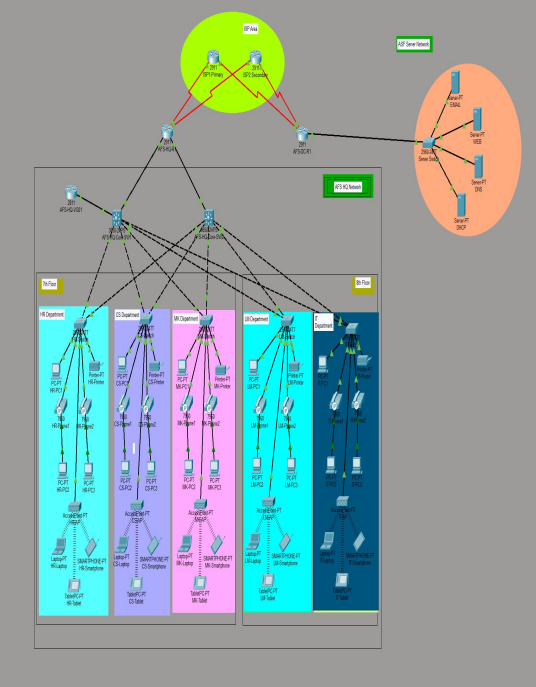
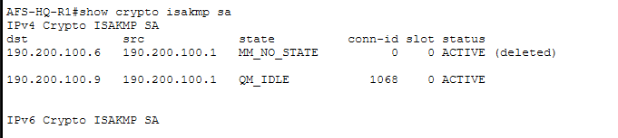
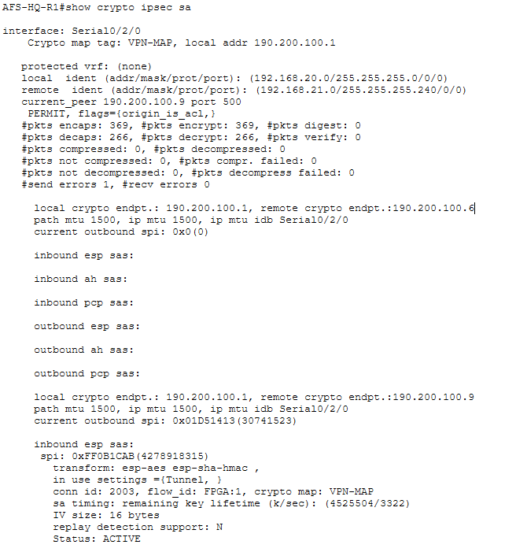
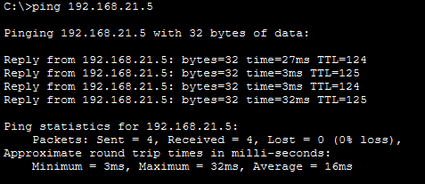
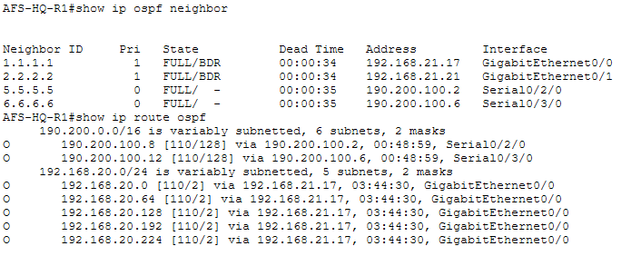
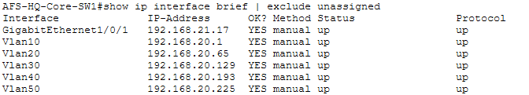
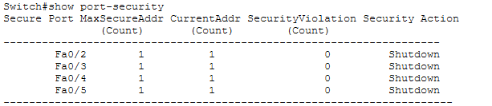
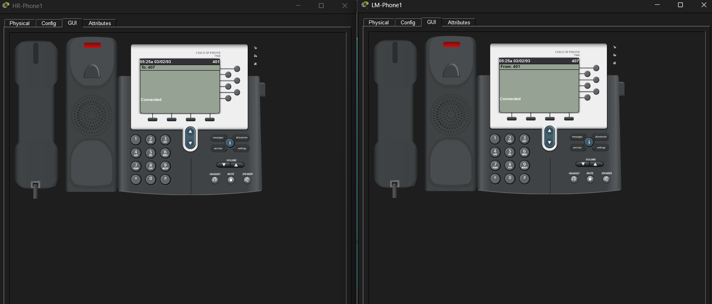

# Secure Multi-Site Financial Network Infrastructure

Enterprise branch-to-datacenter network simulation designed in Cisco Packet Tracer. The topology connects a multi-department corporate headquarters to a centralized data center over redundant WAN providers, secured via site-to-site IPsec tunneling and strict Layer 2/3 traffic controls.

---

## Topology & Addressing Architecture



### Headquarters (HQ LAN)
Inter-VLAN routing is handled on the distribution core switch using IEEE 802.1Q encapsulation with the following subnet allocations:
- **HR (VLAN 10):** `192.168.20.0/26`
- **Customer Service (VLAN 20):** `192.168.20.64/26`
- **Marketing (VLAN 30):** `192.168.20.128/26`
- **Legal (VLAN 40):** `192.168.20.192/27`
- **IT Operations (VLAN 50):** `192.168.20.224/27`
- **Voice (VLAN 120):** `10.10.10.0/24` (Cisco CallManager Express)

### Data Center (DC LAN)
- **Services Subnet:** `192.168.21.0/28` (Hosting DHCP, DNS, Web, and Mail appliances)

### WAN Infrastructure
- Redundant serial point-to-point links configured across two upstream service providers (`190.200.100.0/30` segments).

---

## Implementation Details

### Site-to-Site IPsec VPN
Secure tunnel terminated between `AFS-HQ-R1` (`190.200.100.1`) and `AFS-DC-R1` (`190.200.100.9`):
- **Phase 1 (ISAKMP SA):** AES-256 encryption, SHA hashing, Diffie-Hellman Group 5, pre-shared authentication.
- **Phase 2 (IPsec SA):** ESP-AES transform-set with ESP-SHA-HMAC integrity.
- **Traffic Selector:** Extended ACL 110 configured on edge routers defining local-to-remote subnet policies.
- **NAT Exemption (NAT Bypass):** Policy route maps deployed to exempt inter-site VPN traffic from dynamic PAT translation.

### Dynamic Routing & Core Switching
- Single-area OSPF (Area 0) deployed across internal core switches and edge routers.
- Headquarters departmental routes summarized into a `/24` prefix (`192.168.20.0/24`) at the edge to reduce routing overhead.

### Security Hardening & Edge Controls
- **Management Access:** Restrictive ACL applied on Line VTY interfaces permitting SSHv2 exclusively from the IT subnet (`192.168.20.224/27`).
- **Layer 2 Security:** Port security enabled on server access switches with single MAC sticky learning and `shutdown` violation action.

### IP Telephony (VoIP)
- Cisco 2811 integrated with CallManager Express (CME).
- Configured dynamic DHCP Option 150 for TFTP provisioning, assigning directory numbers (401 through 420) over dedicated Voice VLAN 120.

---

## Validation & Verification

### 1. IPsec Phase 1 ISAKMP State
Verified Phase 1 negotiation achieving `QM_IDLE` status:


### 2. IPsec Packet Counters & Encapsulation
Inspected crypto session statistics validating continuous packet encryption/decryption across the tunnel:


### 3. End-to-End Inter-Site Reachability
Verified bidirectional ICMP reachability from HQ hosts to the Data Center application host (`192.168.21.5`):


### 4. Dynamic Routing Convergence (OSPF)
Verified neighbor adjacencies across core links:


### 5. Multilayer Switch SVI Status
Core switch interface and SVI configuration state:


### 6. Switchport Security Compliance
Verified port-security enforcement and violation modes on access interfaces:


### 7. VoIP CME Session Establishment
Active voice call established between extension 401 (HR) and extension 407 (Legal):


---

## Repository Structure

```text
├── AFS-DC-R1.txt
├── AFS-HQ-R1.txt
├── Financial Institution Enterprise Network Design.pkt
├── cross_site_ping_success.png
├── ipsec_packet_counters.png
├── ipsec_phase1_qm_idle.png
├── ospf_neighbor_and_routes.png
├── port_security_active.png
├── topology.png
├── vlan_svi_status.png
├── voip_connected_call.png
└── README.md
